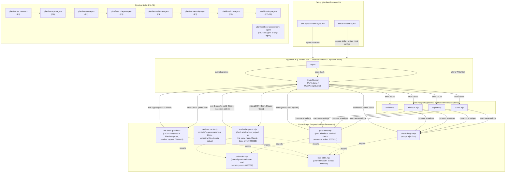

# Architecture Overview

> Living document. Reflects current system state. Updated after every pipeline run.
> Do not archive this file; update it in place.

Last updated: 0000032-governance-continuity-and-write-gate-scope (17 Oct 2026)

---

## System Summary

Planifest is a CLI tooling framework that enforces a structured design pipeline for agentic coding agents. It installs enforcement hooks into agentic IDEs (Claude Code, Cursor, Windsurf, GitHub Copilot, Codex) that gate writes to `src/` behind a confirmed design document, and provides a suite of pipeline skills (spec, ADR, codegen, validate, security, docs, ship) that guide development from brief to merged PR.

---

## Components

| Component | Type | Purpose | Status |
|-----------|------|---------|--------|
| `setup-hook-integration` | component-pack | setup.sh/ps1 and skill-sync: installs enforcement hooks, commit standards, external skill management, and (0000020) a per-tool flags-used marker into any Planifest-managed project | active |
| `planifest-refresh-setup` | skill (standalone, not a src/ component) | Detects a Planifest install's target tool, reconstructs the setup flags in effect from the flags-used marker or hook wiring, confirms with the human on the loop, and safely re-invokes setup.sh/setup.ps1; see `planifest-framework/skills/planifest-refresh-setup/SKILL.md` | active |

---

## Communication Patterns

---

## Governance Loops (0000016)

The pipeline has an optional loop layer, entirely toggle-gated via `planifest-overrides/loop-toggles.yml` (absent = all off; zero-config behaviour identical to pre-0000016):

| Loop | Seam | Verifier | Deterministic guard |
|------|------|----------|--------------------|
| P0 completeness | P0 exit | Gate checklist re-evaluated per coaching round | 2-rounds-per-gap escalation |
| Design critic | End of P1/P2 | Fresh-context `planifest-design-critic` (REJECT-default) + `scripts/consistency-check.mjs` | Cap 3, no-progress halt |
| Governed reversal | P3–P6 blocked by upstream P0–P6 artifact | Fresh-context `planifest-reversal-assessor` (DENY-default) | Budget 2/feature, cascade >3 human gate, ratchet-check.mjs on writes |
| Verify-by-execution | P4 after CI | `planifest-verify-by-execution` (runs the software) | Feeds existing P4 cap-5 loop |
| Cross-model review | End of P6, strictly pre-P7-archive | Fresh-context reviewer on a different model id (REJECT-default) | Cap 3; blocks P7 on cap-without-approval |

Shared mechanics (state file, append-only run log, stop rules, escalation format) live in `planifest-loop-runner`. P7 remains the lock line: no loop or reversal touches archived state (`plan/backlog/` is the governed home for deferred work instead).

---

## Shared hook modules (0000028)

Hook files import their shared helper by relative path instead of carrying their own copy. `read-stdin.mjs` lives in `hooks/enforcement/`, which installs unconditionally, so every hook that imports it finds it on every install. A helper with an always-installed caller belongs in that tree. The reverse placement would leave an always-installed hook importing an absent module, which fails at ESM module-load time before the hook's own `try/catch` runs and so defeats the exit-zero invariant.

Self-modification sequencing (ADR-004) governs how such a change is applied to hooks that are executing the build doing the editing. Rewire one caller, commit, re-run `setup.sh` for that edit alone, then assert a real side effect. Exit 0 proves nothing here by design.

---

## Continuous integration (0000031)

`.github/workflows/planifest.yml` runs four jobs on every pull request to `main`.

| Job | Runner | What it checks |
|-----|--------|----------------|
| `validate-branch` | `ubuntu-latest` | A change under `src/` also touches `plan/`, `docs/`, or a `component.yml` |
| `self-description-check` | `ubuntu-latest` | The README matches the repository structure (0000019) |
| `test-suite` | `ubuntu-latest` and `macos-latest`, `fail-fast: false` | `run-tests.sh` passes. On failure, the log lists each failed suite by file name. |
| `setup-powershell` | `windows-latest`, PowerShell 7 | `test_setup.ps1` passes, including the live `.planifest-setup-flags` marker checks |

The `test-suite` and `setup-powershell` jobs are repository-only (0000031-ADR-002). The consumer copy at `planifest-framework/hooks/planifest.yml` doesn't carry them. Both declare `permissions: contents: read` and `timeout-minutes: 10` (0000031-ADR-003). Windows PowerShell 5.1 has no CI coverage (0000031-ADR-001).

A red check doesn't block a merge until branch protection marks it as required. Only the human on the loop can change that setting.

---

## Run lifecycle and write gate scope (0000032)

### Session markers and close-out

The orchestrator writes three committed session markers at P0:

- `plan/.orchestrator-active`
- `plan/.orchestrator-ack`
- `plan/.run-mode`

Since 0000032-ADR-002, P7 no longer touches them. A new P9 step, "Clear session markers", runs after P8 and before the Step 9 tag. It stages the archive, deletes the markers, and commits both together. It then runs `git ls-files` on the three paths and stops before the tag if any path is still tracked. Hooks therefore treat P8 and P9 as part of the run, and the tag never carries a marker.

Resume Detection in the orchestrator reads archive evidence to finish an interrupted close-out:

- Step 2a fires when the sentinel is present and `plan/current/` is empty. With no `build-report.md` in the matching archive, it resumes at P8. With one, it resumes at the P9 marker step.
- Step 2b fires when the sentinel is gone from disk but still committed. It applies the same archive rule.
- If no archive matches, or the sentinel ID fails its format check, either step stops and asks the human on the loop. Neither step deletes a marker or starts fresh.

### Blocking context clear after P9

Ship Step 12 asks the human on the loop to run `/clear` or start a new session (0000032-ADR-003). The orchestrator refuses new work in the same session until that happens. In the next session, `auto-trigger-orchestrator.mjs` says no Planifest run is active, and the agent must triage the request before it acts. A ship Hard Limit makes every P9 handover note route each next step through a track.

### Shared path rules and repository root

`hooks/enforcement/path-rules.mjs` holds every gated-path rule (0000032-ADR-004). `gate-write.mjs` and `shell-write-guard.mjs` import it, so the two gates can't disagree about a path. It sits in `hooks/enforcement/`, so every install that copies `gate-write.mjs` copies it too.

The module finds the repository root with a marker walk that spawns no process:

1. It walks up from `CLAUDE_PROJECT_DIR`, then from `cwd`, and takes the first walk that finds a marker.
2. In each walk, the nearest folder holding `planifest-framework/` wins. Failing that, the nearest folder holding `.git` wins.
3. A marked folder inside `plan/` or `docs/` of a higher marked folder is never the root.
4. With no marker found, the root is `cwd`.

The module looks up the sentinel and `plan/current/design.md` from the root. A target outside the root passes with no output. A target too long to judge, over 4096 characters or 256 segments, passes with a warning on stderr.

### Block reasons on stderr

Every enforcement hook that exits 2 writes a plain-text reason to stderr, where Claude Code reads it (0000032-ADR-005). The covered hooks are `gate-write.mjs`, `ratchet-check.mjs`, `em-dash-guard.mjs`, and `shell-write-guard.mjs`. The existing hooks keep their stdout byte for byte, so the Windsurf, Copilot, and Codex adapters still relay it.

### Bash shell-write guard

`shell-write-guard.mjs` runs on Claude Code's Bash PreToolUse event (0000032-ADR-006). It finds common shell writers:

- redirects
- `tee`
- `sed -i` and `perl -i`
- the destination of `cp`, `mv`, `install`, and `ln`
- every argument of `rm`, `touch`, and `mkdir`

It judges each target with `toRootRelative` and `evaluateWrite` from `path-rules.mjs`. It tracks the folders each command may run in after `cd`, `pushd`, and `popd`, and judges a relative target against each one. If it can't parse a command or a target, it writes a warning to stderr and allows it. It ignores `git` and can't see writes made inside scripts or interpreters. A boot-file Hard Limit in `standard-boot.md` and `cursor-boot.md` covers those gaps: code changes go through **Write** or **Edit**, never Bash.

`setup.sh` and `setup.ps1` register the guard on a `Bash` PreToolUse matcher for Claude Code only. Each removes any earlier `shell-write-guard` group before it adds one, so a re-run leaves exactly one. Other tools rely on the boot-file rule alone. The 0.31.0 migration tells downstream projects to re-run setup.

---

## Data Ownership

No components own persistent data. Planifest operates on local filesystem artifacts (plan/ files, skill SKILL.md files) written and read during pipeline execution. No databases. New in 0000016 (all plain markdown/YAML, git-tracked): `plan/backlog/` entries (orchestrator-owned, filed by any phase agent), `product.yml` (ship-agent writes, orchestrator reads), and `plan/current/` loop-state/run-log/defect-report/revision-log artifacts (orchestrator-owned). New in 0000020 (local, gitignored, not version-tracked): `<tool-dir>/.planifest-setup-flags`, owned by `setup-hook-integration`, written on every successful install and read/updated by `planifest-refresh-setup`. New in 0000025 (git-tracked, additive to the 0000020 marker, not a replacement): `planifest-overrides/setup-config/{tool}.md`, one file per AI tool, written by `setup.sh`/`setup.ps1` alongside the existing gitignored marker so the flags in effect at install time are versioned and reviewable, not only locally cached.

Clarified in 0000032: `planifest-framework` owns the three committed session markers, `plan/.orchestrator-active`, `plan/.orchestrator-ack`, and `plan/.run-mode`. The orchestrator writes them at P0, and the ship skill deletes them in the P9 marker step. Hooks read them only.

---

## External Dependencies

| Dependency | Type | Components That Use It |
|-----------|------|----------------------|
| Node.js (built-ins only: fs, path, child_process, os, url) | Runtime | All hook adapters and enforcement scripts |
| Bash | Runtime | setup.sh, test scripts, hook install scripts |
| PowerShell 7+ | Runtime | setup.ps1, test_setup.ps1, PowerShell hook scripts |
| GitHub Actions hosted runners | CI | `ubuntu-latest`, `macos-latest`, and `windows-latest` jobs in `.github/workflows/planifest.yml` (0000031) |
| git (core.hooksPath) | CLI | setup.sh/ps1 (commit-msg hook installation) |

---

## Key Architectural Decisions

Reference `docs/decisions-index.md` for the full ADR list.

- **ADR-001 (0000003):** Three-tier enforcement model: Claude Code (Tier 1a), other IDEs (Tier 1b), instructions-only (Tier 2)
- **ADR-002 (0000003):** Common envelope shape: all adapters normalise to `{ session_id, cwd, tool_input, event }` before delegating
- **ADR-005 (0000003):** Exit-zero failure mode: hooks never block on unexpected errors (NFR-003)
- **ADR-003 (0000011):** Hook adapter architecture: delegating pattern; adapters translate envelopes, enforcement logic lives only in shared scripts
- **ADR-003 (0000018):** discovery.md elevated to Hard Limit status: matches build-log.md's Hard Limit 8 enforcement pattern
- **ADR-001 (0000020):** Hardcoded, non-extensible deletion allowlist for the refresh skill, enforced in a dedicated script, not prose alone (P5 security finding)
- **ADR-002 (0000020):** Single marker file (`.planifest-setup-flags`) serves as both install-time record and refresh retry cache, not two separate files
- **ADR-003 (0000020):** Mandatory human confirmation gate before any refresh action, regardless of flag-reconstruction confidence
- **ADR-004 (0000020):** Tool selection is explicit input to the refresh skill, never silently auto-resolved when multiple installs are present
- **ADR-005 (0000020):** No automatic retry on a failed setup re-invocation; retry is always human-initiated
- **ADR-001 (0000024):** `product.yml` extended to single-component projects as the declared product id home (stable name for versioning and for attributing archived runs): extends, not supersedes, 0000016 ADR-002's versioning-only scope
- **ADR-001 (0000025):** Ship-agent PR footer defaults off; restorable only via a `planifest-overrides/instructions/` opt-in file
- **ADR-002 (0000025):** `planifest-overrides/setup-config/{tool}.md` (tracked) is source of truth over the gitignored `.planifest-setup-flags` marker; reconciled on setup/refresh; `.orchestrator-strict` explicitly out of scope
- **ADR-003 (0000025):** Scope Lock Challenge defaults to always-drafted, batch-presented answers: supersedes **ADR-003 (0000017)**, scoped narrowly against `0000014-ADR-008`'s one-question-at-a-time convention (unchanged everywhere else)
- **ADR-002 (0000028):** Shared hook modules live inside the existing `hooks/enforcement/` tree, which installs unconditionally, never in a new top-level `shared/` directory
- **ADR-003 (0000028):** The em dash guard attaches as a `PreToolUse(Write, Edit)` sibling of `gate-write.mjs`, not a git hook, with a reusable in-content sentinel as the bypass so the exemption is visible in the artifact's own diff
- **ADR-004 (0000028):** Self-modification sequencing: when editing the hooks running the build, rewire one caller at a time and verify a real side effect, because exit 0 cannot distinguish a working hook from a silently broken one
- **ADR-002 (0000030):** The retired hook and MCP integrations are removed from the framework. Setup ignores their flags and a re-run cleans up the old install.
- **ADR-003 (0000030):** Setup still accepts the three retired integration flags. Each prints a one-line notice, is never written to the install marker, and never fails a refresh.
- **ADR-004 (0000030):** The clean-up runs on every setup run. It matches on command path, skips a malformed settings file byte-identical, writes through a temporary file, and always exits 0.
- **ADR-005 (0000030):** `setup-hook-integration` owns removal of the stale state the deleted hooks wrote, including the two `plan/` marker folders.
- **ADR-002 (0000032):** Session markers stay committed and are cleared in a P9 step after P8 and before the tag. An interrupted close-out resumes from archive evidence. Supersedes **ADR-001 (0000015)** and amends **ADR-004 (0000015)**.
- **ADR-003 (0000032):** P9 ends with a blocking context clear, and the next session must triage first. Supersedes **ADR-002 (0000015)**.
- **ADR-004 (0000032):** One module, `path-rules.mjs`, holds the gated-path rules and the repository-root walk. Targets outside the root pass.
- **ADR-005 (0000032):** Every enforcement hook that exits 2 writes its reason to stderr and keeps its existing stdout.
- **ADR-006 (0000032):** A heuristic Bash shell-write guard, registered for Claude Code only, fails open and is backed by a boot-file Hard Limit.

---

*Template: architecture-overview.template.md*
