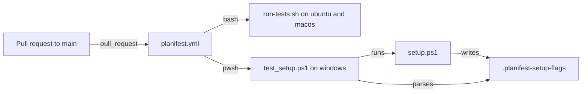

# Execution Plan - CI test and PowerShell coverage

> Every requirement must be traceable to a user story or acceptance criterion.

**Skill:** [spec-agent](../../planifest-framework/skills/planifest-spec-agent/SKILL.md)
**Feature:** 0000031-ci-test-and-powershell-coverage
**Version:** 0.30.0
**Status:** active

## Active Skills

| Skill | Scope | Purpose |
|-------|-------|---------|
| None | n/a | n/a |

## Functional Requirements Directory

| File | Requirement |
|------|------------|
| [req-001-suite-ci-job.md](requirements/req-001-suite-ci-job.md) | CI runs `run-tests.sh` on Linux and macOS (US-001). |
| [req-002-failed-suite-list.md](requirements/req-002-failed-suite-list.md) | `run-tests.sh` names each failed suite (US-001). |
| [req-003-windows-pwsh-ci-job.md](requirements/req-003-windows-pwsh-ci-job.md) | CI runs `test_setup.ps1` under PowerShell 7 on Windows (US-002). |
| [req-004-setup-flags-marker-check.md](requirements/req-004-setup-flags-marker-check.md) | `test_setup.ps1` checks the setup-flags marker (US-003). |

## Non-Functional Requirements

| ID | Category | Requirement | Target | Measurement |
|----|----------|------------|--------|-------------|
| NFR-001 | Performance | Each new CI job finishes quickly. | Under 10 minutes per job, enforced by `timeout-minutes: 10` | GitHub Actions job timing on the feature PR |
| NFR-002 | Reliability | Jobs give the same result on the same commit. | 2 consecutive green runs on the final commit | Re-run the workflow once |
| NFR-003 | Security | Jobs hold the least token access. | `permissions: contents: read`, no secrets, `pull_request` trigger only | Workflow file review at P5 |

## API Summary

Not applicable. This feature adds no API.

## Data Model Summary

Not applicable. This feature owns no data.

## Component Interactions

## Assumptions

| ID | Assumption | Impact if Wrong |
|----|-----------|----------------|
| A-001 | The suite passes on Linux as it does on macOS. | The Linux leg starts red. |
| A-002 | `windows-latest` runners ship PowerShell 7 as `pwsh`. | The Windows job needs an install step. |
| A-003 | `test_setup.ps1` runs unchanged on Windows. | The script needs fixes that only CI can check. |

## Open Questions

None.
