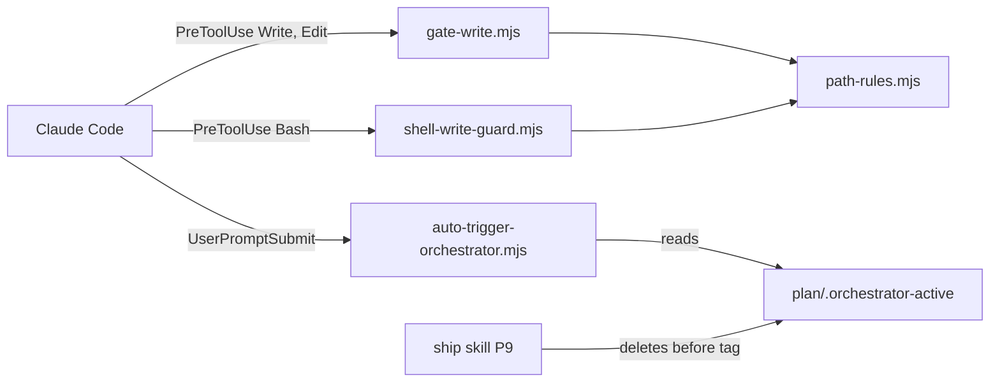

# Execution Plan - Governance continuity and write-gate scope

> Every requirement must be traceable to a user story or acceptance criterion.

**Skill:** [spec-agent](../../planifest-framework/skills/planifest-spec-agent/SKILL.md)
**Feature:** 0000032-governance-continuity-and-write-gate-scope
**Version:** 0.31.0
**Status:** active

## Active Skills

| Skill | Scope | Purpose |
|-------|-------|---------|
| None | | No capability skills apply to this run |

## Functional Requirements Directory

Each file covers one user story and follows the [Requirement Template](../../planifest-framework/templates/requirement.template.md).

| File | Requirement | Brief criteria |
|------|------------|----------------|
| [req-001-marker-clear-before-tag.md](requirements/req-001-marker-clear-before-tag.md) | As the human on the loop, I want the ship skill to delete the session markers in P9 before the tag, so that hooks treat P8 and P9 as part of the run. | AC-1 |
| [req-002-resume-from-archive-evidence.md](requirements/req-002-resume-from-archive-evidence.md) | As the human on the loop, I want an interrupted close-out to resume from archive evidence, so that P8 and P9 finish as part of the same run. | AC-2 |
| [req-003-no-run-triage-message.md](requirements/req-003-no-run-triage-message.md) | As the human on the loop, I want the auto-trigger hook to say no run is active and to require triage, so that the agent routes every new request into a track. | AC-3 |
| [req-004-handover-note-routing.md](requirements/req-004-handover-note-routing.md) | As the human on the loop, I want each next step in a P9 handover note routed through a track, so that no follow-up code change skips the pipeline. | AC-4 |
| [req-005-blocking-context-clear.md](requirements/req-005-blocking-context-clear.md) | As the human on the loop, I want P9 to end with a blocking context clear, so that every new request starts in a fresh session and goes through triage. | AC-5 |
| [req-006-outside-repository-pass.md](requirements/req-006-outside-repository-pass.md) | As an agent, I want `gate-write` to ignore paths outside the repository, so that a write outside the repository never needs a design. | AC-6 |
| [req-007-stderr-block-reasons.md](requirements/req-007-stderr-block-reasons.md) | As an agent, I want every enforcement hook that blocks to show its reason, so that I can act on a block without reading the hook's source. | AC-7 |
| [req-008-shell-writer-detection.md](requirements/req-008-shell-writer-detection.md) | As the human on the loop, I want the shell guard to catch the common shell writers aimed at gated paths, so that auto mode cannot bypass the design gate through Bash. | AC-8 |
| [req-009-shell-guard-path-parity.md](requirements/req-009-shell-guard-path-parity.md) | As the human on the loop, I want the shell guard to gate exactly the paths that **Write** and **Edit** gate, so that the two gates never disagree and read-only commands never block. | AC-9 |
| [req-010-shell-guard-registration.md](requirements/req-010-shell-guard-registration.md) | As the human on the loop, I want both setup scripts to register the shell guard for Claude Code exactly once, so that every install runs the guard and a re-run never duplicates it. | AC-10 |
| [req-011-rerun-setup-migration.md](requirements/req-011-rerun-setup-migration.md) | As the human on the loop, I want a migration that tells downstream projects to re-run setup, so that they gain the shell guard and the new hook messages. | AC-11 |
| [req-012-write-or-edit-boot-rule.md](requirements/req-012-write-or-edit-boot-rule.md) | As the human on the loop, I want every boot file to require code changes through **Write** or **Edit**, so that the agent doesn't rely on the shell guard's heuristic. | Constraint (boot-file rule) |

Build order: req-001 first, then req-002 to req-005, because all five edit the ship or orchestrator skill. req-006 first, then req-007 to req-009, because they import `path-rules.mjs`. req-010 to req-012 follow req-008. The skill stream and the hook stream touch different files and can run in parallel.

## Non-Functional Requirements

| ID | Category | Requirement | Target | Measurement |
|----|----------|------------|--------|-------------|
| NFR-001 | Performance | Changed and new hooks stay fast | Under 200 ms per call on the CI runners | Timed in the req-007 and req-009 suites |
| NFR-002 | Reliability | Hooks fail open on unexpected input | Exit 0 for malformed stdin, JSON with no `command`, and a non-string `command` | Fail-open cases in each changed or new hook's suite |
| NFR-003 | Accuracy | The shell guard doesn't block read-only commands | Zero blocks on the false-positive corpus | Corpus test in the req-009 suite |
| NFR-004 | Accuracy | The shell guard catches the AC-8 writer forms | Blocks every command in the detection corpus | Corpus test in the req-008 suite |

## API Summary

Not applicable. This feature changes skills, hooks, and setup scripts, and exposes no API.

## Data Model Summary

| Entity | Owner Component | Key Fields | Relationships |
|--------|----------------|------------|--------------|
| `plan/.orchestrator-active` | planifest-framework | feature ID | Read by hooks and Resume Detection. Locates the archive at step 2a. |
| `plan/.orchestrator-ack` | planifest-framework | session ID or timestamp | Read by `check-orchestrator-presence.mjs` |
| `plan/.run-mode` | planifest-framework | `continuous` or `interactive` | Read at resume |

## Component Interactions

## Assumptions

Each is a risk item with likelihood: medium.

| ID | Assumption | Impact if Wrong |
|----|-----------|----------------|
| A-001 | Claude Code shows a PreToolUse block reason from stderr when a hook exits 2 | AC-7 fixes nothing for Claude Code |
| A-002 | Claude Code passes the Bash command as `tool_input.command` | The shell guard never sees a command and always passes |
| A-003 | Hooks look up `plan/` and `design.md` from the repository root, with no `git` spawn. The root is the nearest folder holding `planifest-framework/`, then the nearest holding `.git`, then `cwd`. The walk starts at `CLAUDE_PROJECT_DIR` when it names a folder and finds a marker, and at `cwd` otherwise. A marker inside `plan/` or `docs/` never counts (security findings F1, N-4, and N-5). | A session started in a subfolder would see no design and block every gated write |
| A-004 | Both sides of the root comparison use real paths. A missing target resolves through its nearest existing parent. | An in-repository write could look outside and bypass the gate |
| A-005 | The `plan/current/` sentinel check applies to shell writes too, because the guard matches `gate-write` exactly | Shell writes to plan artifacts before P0 would be blocked. That is the intended parity. |
| A-006 | A write target with a glob or variable is judged by its literal prefix. A target with no literal prefix gets a warning and passes. A `cd` with one literal argument is tracked. A command joined to that `cd` by `&&` is judged against the folder after the `cd` alone (security finding N-1). After any `cd` that may not have run, a relative target is also judged against the starting folder, and blocks if either blocks (security finding F2). | `cp a "$DIR/x"` passes the guard. The boot-file rule covers it. |
| A-007 | Tools that relay both stdout and stderr show a block reason twice | The reason appears twice in Cursor, Cline, and OpenCode, and nothing breaks |
| A-008 | Both `standard-boot.md` and `cursor-boot.md` gain the Write-or-Edit rule. Tools without the shell guard need the rule most. | None. The rule is text only. |

## Open Questions

None. The human on the loop reviewed A-003 to A-008 after P1. A-003 to A-005 were confirmed one at a time. A-006 to A-008 took the orchestrator's recommendation when the human returned to continuous mode.
